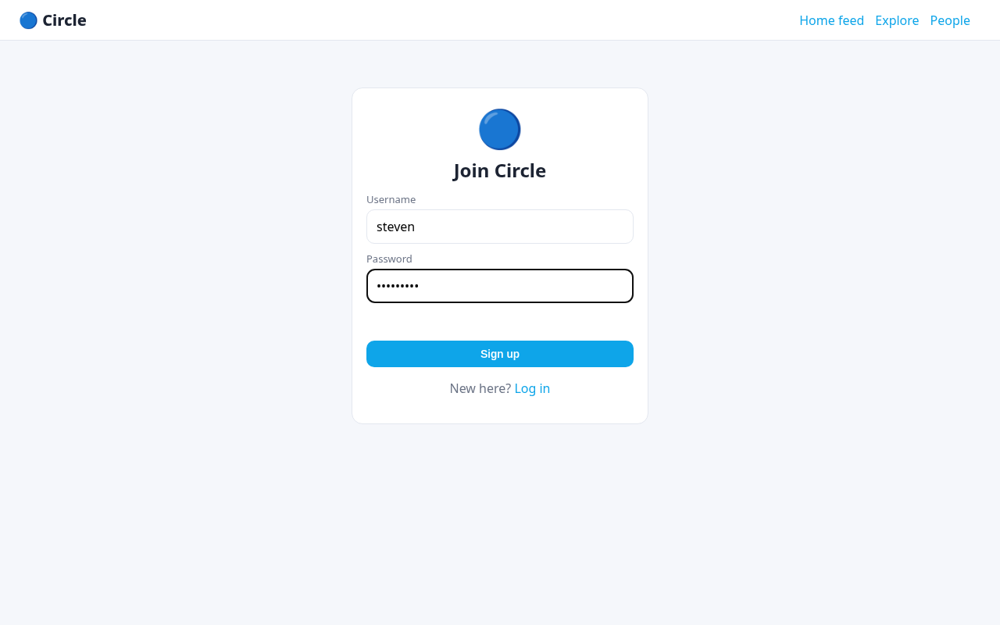
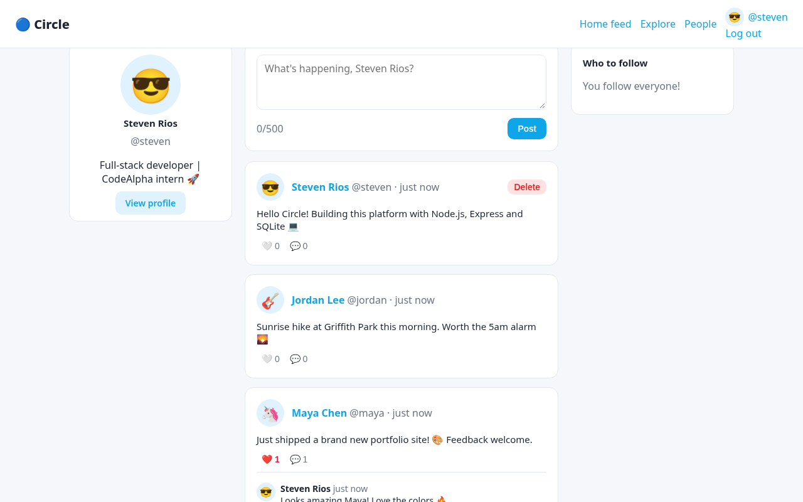
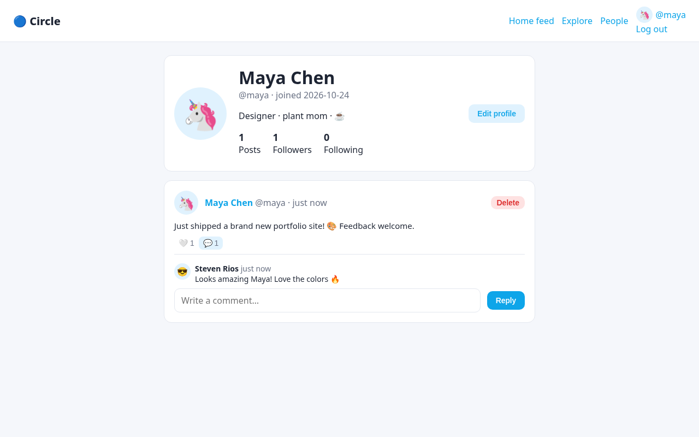
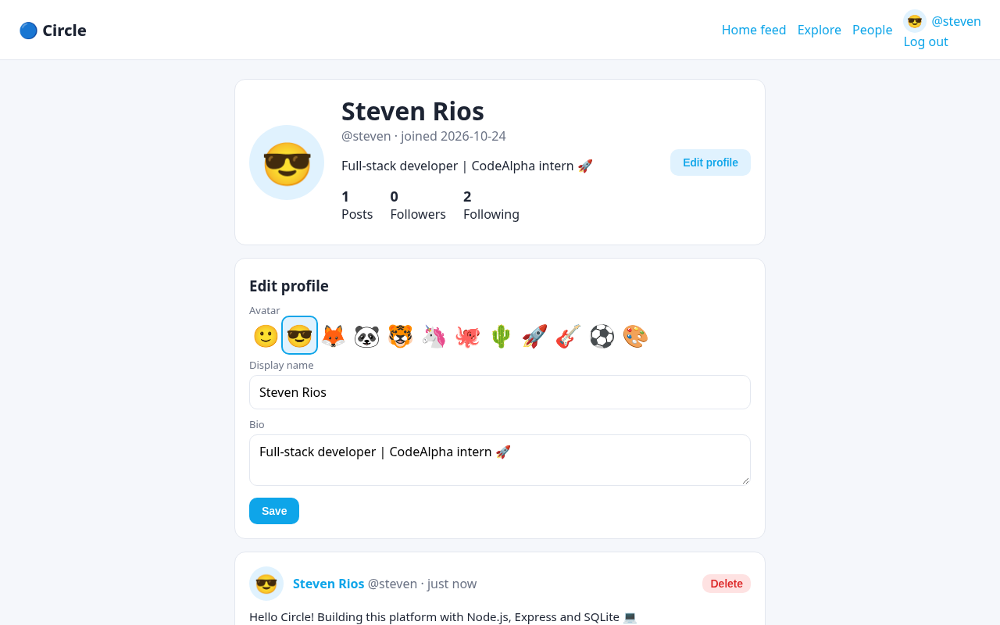
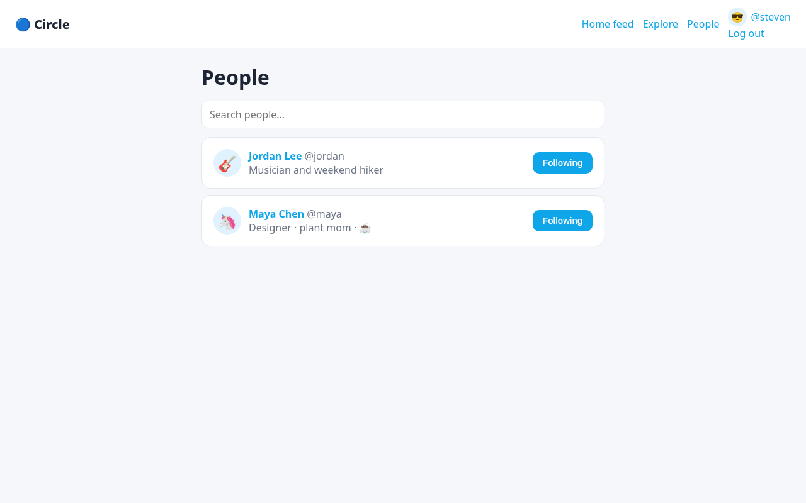
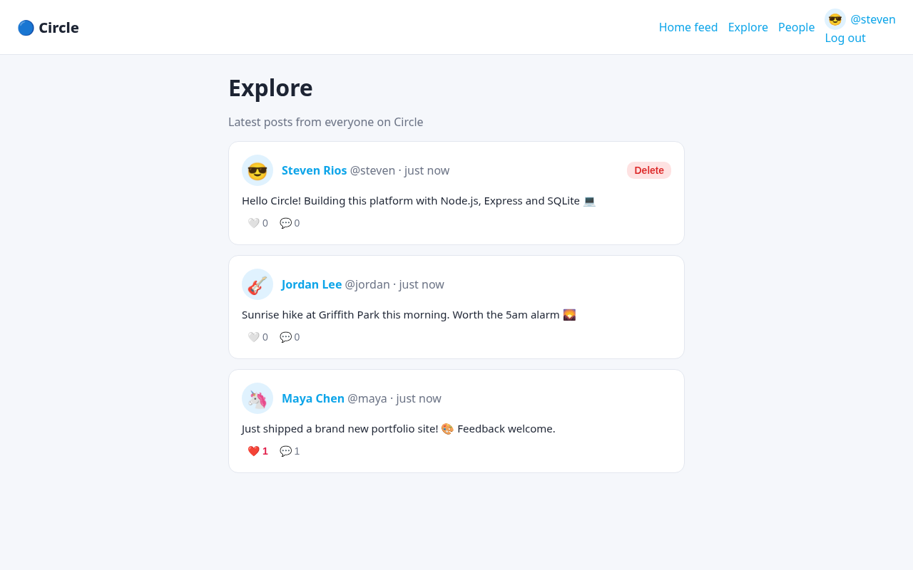

# Circle — Social Media Platform

CodeAlpha Full Stack Development Internship — **Task 2: Social Media Platform**


## Features

- Sign up / log in (bcrypt + JWT)
- User profiles with display name, bio and emoji avatar (editable)
- Create and delete posts (500-char limit)
- Like / unlike posts and comment on them
- Follow / unfollow users with follower & following counts
- Personalised home feed (you + people you follow) and an Explore feed
- People search and "who to follow" suggestions

## Tech stack

- **Backend:** Node.js 20+, Express 5, SQLite (better-sqlite3)
- **Auth:** bcrypt password hashing (bcryptjs) + JSON Web Tokens
- **Frontend:** vanilla HTML, CSS and JavaScript (single-page app, no framework)
- **Tests:** Node's built-in test runner + Supertest — 9 tests, run on GitHub Actions (Node 20 & 22)

## Getting started

```bash
git clone https://github.com/x3r01432/CodeAlpha_SocialMediaPlatform.git
cd CodeAlpha_SocialMediaPlatform
npm install
npm start
```

Open <http://localhost:3000>. The SQLite database (`social.db`) is created automatically on first run.

Configuration (optional environment variables): `PORT` (default 3000), `JWT_SECRET` (set this in production — otherwise a random secret is generated on each start), `DB_FILE`.

```bash
npm test
```

## API overview

- `POST /api/auth/register`, `POST /api/auth/login`, `GET/PUT /api/me`
- `GET /api/users?q=`, `GET /api/users/:username`, `POST/DELETE /api/users/:username/follow`
- `GET /api/feed`, `GET /api/explore`, `POST /api/posts`, `DELETE /api/posts/:id`
- `POST/DELETE /api/posts/:id/like`, `GET/POST /api/posts/:id/comments`

## Screenshots

**Signup**



**Home feed**



**Profile with like and comment**



**Edit profile**



**People follow**



**Explore**



## Author

**Steven Manuel Rios** ([@x3r01432](https://github.com/x3r01432)) — built for the CodeAlpha Full Stack Development internship.

## License

[MIT](LICENSE) © 2026 Steven Rios
